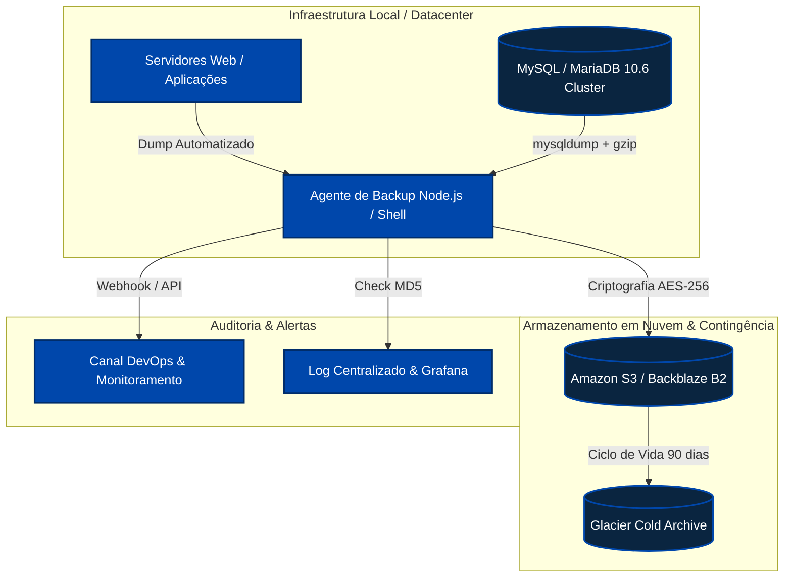
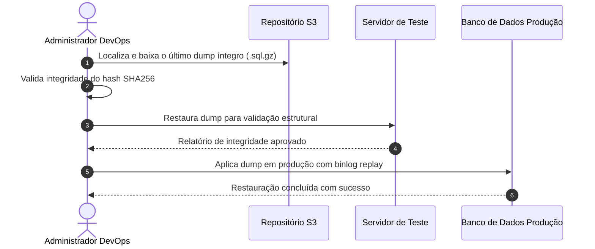

# Plano de Continuidade e Procedimento Operacional de Backup

Este documento técnico consolida a política de contingência, rotinas de salvaguarda de dados e o plano de recuperação de desastres (*Disaster Recovery*) para os sistemas centrais da **Organização / Departamento de TI**.

> [!IMPORTANT]
> A integridade dos volumes deve ser validada semanalmente via ambiente de *staging*. Qualquer falha no checksum MD5/SHA256 deve acionar imediatamente a equipe de DevOps e Infraestrutura.

---

## 1. Topologia da Arquitetura de Backup

O fluxo abaixo descreve a sincronização entre a camada de aplicação, instâncias de banco de dados e os *buckets* de armazenamento em nuvem e replicação fria (*cold storage*).



---

## 2. Automação com Ansible

Playbook automatizado para distribuição das chaves SSH, instalação das dependências de criptografia e agendamento dos cronjobs de sincronização.

```yaml
---
- name: Configurar Rotinas de Backup na Infraestrutura Corporativa
  hosts: all_production_servers
  become: yes
  vars:
    backup_root_dir: /var/backups/corp
    retention_days: 30
    s3_bucket_destination: s3://empresa-backups-infra-prod/databases/

  tasks:
    - name: Garantir diretórios estruturados com permissões restritas
      ansible.builtin.file:
        path: "{{ item }}"
        state: directory
        owner: root
        group: root
        mode: '0700'
      loop:
        - "{{ backup_root_dir }}/daily"
        - "{{ backup_root_dir }}/monthly"
        - "{{ backup_root_dir }}/scripts"

    - name: Instalar ferramentas auxiliares de compactação e sincronização
      ansible.builtin.apt:
        name:
          - awscli
          - pigz
          - rhash
          - jq
        state: present
        update_cache: yes
```

---

## 3. Script de Execução e Dump do Banco de Dados

Comando executado diariamente às `02:00 BRT`. Os parâmetros foram projetados para não travar tabelas transacionais durante o expediente ou janelas de leitura.

```bash
#!/usr/bin/env bash
# ==============================================================================
# Rotina de Backup de Banco de Dados Corporativo
# ==============================================================================
set -euo pipefail

BACKUP_DATE=$(date +"%Y%m%d_%H%M%S")
OUTPUT_FILE="/var/backups/corp/daily/app_prod_${BACKUP_DATE}.sql.gz"

echo "[$(date)] Iniciando extração do cluster MySQL..."
docker exec -i mysql_prod_cluster /usr/bin/mysqldump \
  --single-transaction \
  --quick \
  --quote-names \
  --routines \
  --triggers \
  --hex-blob \
  --default-character-set=utf8mb4 \
  -u root -p"${MYSQL_ROOT_PASSWORD}" app_production | pigz -9 > "${OUTPUT_FILE}"

echo "[$(date)] Calculando assinatura SHA256 do pacote gerado..."
sha256sum "${OUTPUT_FILE}" > "${OUTPUT_FILE}.sha256"

echo "[$(date)] Enviando volume compactado para armazenamento em nuvem..."
aws s3 cp "${OUTPUT_FILE}" "s3://empresa-backups-infra-prod/databases/$(basename "${OUTPUT_FILE}")" \
  --storage-class STANDARD_IA \
  --sse aws:kms \
  --sse-kms-key-id "alias/corp-backup-key"
```

---

## 4. Matriz de Retenção e SLA de Recuperação

| Tipo de Dado | Periodicidade | Retenção Local | Retenção Nuvem | RPO Alvo | RTO Alvo |
| :--- | :--- | :--- | :--- | :--- | :--- |
| **Bancos de Dados Transacionais** | A cada 6 horas | 7 dias | 365 dias (Cold) | &le; 6h | &le; 45min |
| **Arquivos de Mídia e Anexos** | Diário (incremental) | 15 dias | 180 dias | &le; 24h | &le; 2h |
| **Imagens Docker & Configurações** | Semanal / Por Release | 30 dias | Indeterminado | &le; 7 dias | &le; 15min |
| **Logs de Auditoria e Acessos** | Diário | 3 dias | 5 anos | &le; 24h | &le; 4h |

---

## 5. Procedimento de Restauração em Caso de Desastre



> [!TIP]
> Antes de aplicar o dump definitivo no ambiente de produção, certifique-se de pausar os containeres de aplicação para prevenir gravações inconsistentes (`docker compose down --timeout 30`).
