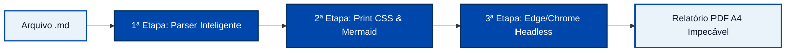

# MARKtoPDF (Executive Edition) 📑🚀

> **Conversor universal de Markdown técnico para relatórios executivos em PDF A4 de alta definição com suporte completo a diagramas Mermaid, sintaxe colorida, sumário executivo (TOC), capas formais, numeração oficial de páginas, personalização de logotipo/empresa (White-Label) e layout anti-barras-de-rolagem, sem dependências pesadas de browsers adicionais (Puppeteer/Playwright).**

Projetado especialmente para documentações de **DevOps, Infraestrutura, Sysadmin, Engenharia de Software, Relatórios Institucionais e Auditoria Corporativa**.

---

## 💡 A Filosofia do Projeto

Gerar PDFs a partir de Markdown com ferramentas tradicionais costuma trazer 3 grandes dores de cabeça:
1. **Barras de rolagem horríveis**: Linhas longas de comandos `docker exec`, `kubectl` ou playbooks Ansible geram barras de rolagem cinzas estáticas cortando o código.
2. **Diagramas quebrados**: Navegadores geram o PDF antes que o JavaScript do Mermaid renderize os nós e posicione as setas.
3. **Dependências gigantescas**: Bibliotecas como Puppeteer baixam mais de 300MB de Chromium redundante e quebram com facilidade em ambientes corporativos restritos.

O **MARKtoPDF** resolve isso de forma elegante através de um pipeline em 3 etapas com motor nativo do SO:



---

## ✨ Recursos Principais

- 🏢 **Totalmente Customizável (White-Label)**: Adicione o **logotipo da sua empresa**, personalize o nome da organização, departamento, diretoria e responsável técnico via CLI ou Web.
- 🎨 **4 Temas Corporativos**: Escolha entre `corporate` (Azul Executivo / Royal Navy), `slate` (Grafite Moderno), `emerald` (Esmeralda Tech / SRE) e `burgundy` (Vinho Clássico / Governança).
- 📑 **Sumário Executivo Automático (TOC)**: Gerado automaticamente a partir de títulos H2/H3 navegáveis com pontilhado dinâmico (`--toc` ou `[TOC]`).
- 📄 **Capa de Rosto Formal**: Página de rosto dedicada com logotipo, título, subtítulo, autor, versão e metadados (`--cover`).
- 🔢 **Numeração de Páginas Oficial**: Cabeçalho e rodapé nativos com formato `"Página X de Y"` em todas as folhas (`--page-numbers`).
- ✂️ **Quebra Manual de Página**: Suporte nativo a `<!-- pagebreak -->` ou `\pagebreak`.
- ⚡ **Modo Turbo Automático**: Detecção inteligente de Mermaid — documentos sem diagramas renderizam até 3x mais rápido.
- 🔒 **Segurança & Concorrência**: Isolamento temporário com `crypto.randomUUID()`, suporte a volumes de leitura e sanitização contra scripts não autorizados.
- 🐳 **Docker & Docker Compose**: Pronto para rodar em produção com um único comando (`docker compose up -d`).
- 🌐 **Exportação HTML Autônomo**: Botão e rota para baixar o documento em HTML único interativo.
- 🧪 **Suíte de Testes Automatizados**: Testes unitários e de integração com o executor nativo do Node.js (`npm test`).

---

## 🛠️ As 3 Etapas Técnicas

### 1ª Etapa: O Parser Inteligente (`marked` customizado)
- Lê o Markdown de entrada via `marked`.
- **Interceptador Customizado**:
  - Quando encontra um bloco `mermaid`, envelopa em `<div class="mermaid" id="...">` com evento de conclusão.
  - Quando encontra blocos de código (`bash`, `yaml`, `sql`, `dockerfile`, etc.), formata em cartões executivos de terminal com cabeçalho, indicador visual de status e badge da linguagem.
  - Converte alertas do GitHub Flavored Markdown (`[!NOTE]`, `[!TIP]`, `[!WARNING]`, `[!IMPORTANT]`) em cartões de destaque executivos.
  - Atribui IDs seguros (`slugify`) aos títulos para navegação interna via Sumário (TOC).
  - Formata checklists e tabelas com wrappers anti-quebra de página.

### 2ª Etapa: Engenharia de CSS para Impressão (Print CSS)
- **Eliminação Total de Barras de Rolagem**:
  ```css
  pre, code {
    white-space: pre-wrap !important;
    word-break: break-word !important;
    overflow-wrap: break-word !important;
  }
  ```
- **Tipografia Executiva com Fallback Offline**:
  - `Inter`, `Segoe UI`, `SF Pro`: Textos institucionais e títulos.
  - `JetBrains Mono`, `Cascadia Code`, `Consolas`: Códigos de terminal e scripts.
- **Prevenção de Quebras de Página Ruins**: Diagramas, blocos de código, tabelas e callouts utilizam `page-break-inside: avoid;`.

### 3ª Etapa: O Motor Chromium Headless (Microsoft Edge / Chrome)
Utiliza o navegador que **já está instalado nativamente no seu Windows, Mac ou Linux**, sem precisar baixar pacotes pesados:
```powershell
msedge.exe --headless=new \
  --disable-gpu \
  --no-sandbox \
  --run-all-compositor-stages-before-draw \
  --virtual-time-budget=8000 \
  --print-to-pdf="relatorio.pdf" "file:///caminho/temporario.html"
```

---

## 🌐 Modo Web (Interface Gráfica Interativa)

Para rodar a aplicação Web completa:

```bash
npm start
```
Acesse no seu navegador: **`http://localhost:3000`**

### Recursos da Interface Web:
- **Barra de Atalhos**: Insira Alertas, Diagramas Mermaid, Comandos Bash, Tabelas e Quebras de Página com 1 clique.
- **Personalização da Marca**: Configure o nome da empresa, departamento e URL do logotipo em tempo real.
- **Seletor de Tema Visual**: Alterne instantaneamente entre Azul Executivo, Grafite, Esmeralda e Vinho.
- **Configurações Rápidas**: Ative Capa de Rosto, Sumário Executivo e Numeração de Páginas.
- **Controles de Zoom A4**: Visualize a folha em 80%, 100% ou 115%.
- **Exportação Dupla**: Gere o **PDF Executivo** ou exporte o **HTML Autônomo** para intranets e e-mails.

---

## 💻 Guia da Linha de Comando (CLI)

```bash
node bin/cli.js <arquivo-markdown> [opções]
```

### Parâmetros e Opções:

| Opção | Abreviação | Padrão | Descrição |
| :--- | :--- | :--- | :--- |
| `--output <caminho>` | `-o` | `<nome>.pdf` | Caminho do arquivo PDF gerado |
| `--org <nome>` | | `Organização / Empresa` | Nome da empresa/instituição no cabeçalho |
| `--department <nome>`| | `Diretoria de Tecnologia` | Nome do departamento/diretoria |
| `--logo <caminho/url>`| | `null` | Caminho local ou URL do logotipo da empresa |
| `--theme <tema>` | | `corporate` | Tema: `corporate` (azul), `slate` (grafite), `emerald` (verde), `burgundy` (vinho) |
| `--toc` | | `false` | Gera sumário executivo automático baseado nos H2/H3 |
| `--cover` | | `false` | Adiciona folha de rosto/capa executiva formal |
| `--author <nome>` | | Equipe Técnica | Nome do autor/responsável na capa |
| `--version-doc <ver>`| | `1.0` | Versão do documento na capa |
| `--page-numbers` | | `false` | Rodapé com numeração oficial `"Página X de Y"` em todas as folhas |
| `--title <titulo>` | `-t` | Automático (H1) | Título exibido no documento |
| `--no-header` | | `false` | Remove o cabeçalho executivo institucional estático |
| `--keep-html` | `-k` | `false` | Mantém o arquivo HTML intermediário para inspeção |
| `--wait <ms>` | `-w` | Dinâmico | Tempo de espera (ms) para execução de scripts |
| `--browser <caminho>`| `-b` | Automático | Caminho manual para o executável do Edge/Chrome |
| `--landscape` | | `false` | Imprime em orientação paisagem (horizontal) |

### Exemplos Práticos:

1. **Conversão simples:**
   ```bash
   node bin/cli.js BACKUP.md
   ```

2. **Relatório completo com Capa, Logotipo, Sumário e Numeração de Páginas:**
   ```bash
   node bin/cli.js BACKUP.md -o "Relatorio_Final.pdf" \
     --org "Acme Corporation" \
     --department "Infraestrutura & Cloud" \
     --logo "https://minhaempresa.com/logo.png" \
     --toc --cover --page-numbers
   ```

3. **Utilizando o tema Esmeralda com autor customizado:**
   ```bash
   node bin/cli.js BACKUP.md --theme emerald --cover --author "João Silva - SRE Lead"
   ```

---

## 🐳 Executando com Docker

Você pode rodar em qualquer servidor com apenas um comando via Docker Compose:

```bash
docker compose up -d
```
Acesse `http://localhost:3000`.

---

## 🧪 Testes Automatizados

O projeto conta com suíte de testes nativa (sem dependências externas pesadas):

```bash
npm test
```

Executa testes para o parser Markdown, interceptador Mermaid, gerador de TOC, injeção de temas e conversão end-to-end de PDF.

---

## 📦 Uso Programático (Módulo Node.js)

```javascript
const { convertMarkdownToPdf, markdownToHtml } = require('./src/index');

async function gerarRelatorio() {
  const resultado = await convertMarkdownToPdf('BACKUP.md', 'dist/backup-oficial.pdf', {
    title: 'Plano de Continuidade Operacional',
    org: 'Minha Empresa S.A.',
    department: 'Diretoria de Tecnologia & Engenharia',
    logo: 'https://minhaempresa.com/logo.png',
    theme: 'corporate',
    toc: true,
    cover: {
      author: 'Equipe de Infraestrutura',
      version: '2.1'
    },
    pageNumbers: true
  });

  console.log(`PDF gerado: ${resultado.pdfPath} (${(resultado.size / 1024).toFixed(1)} KB) em ${resultado.elapsedMs}ms`);
}

gerarRelatorio();
```

---

## 🛡️ Licença
Distribuído sob a licença **MIT**. Desenvolvido com foco em eficiência, estabilidade, personalização e excelência visual.
